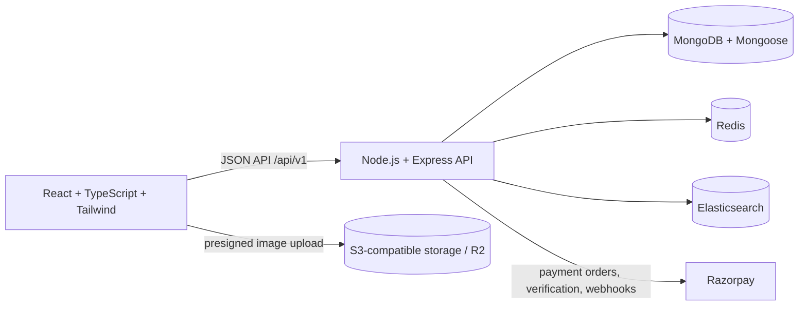

# Marketly

Marketly is a multi-vendor marketplace demo. Customers can browse and search products, manage carts and addresses, apply coupons, place and track orders, and pay through Razorpay test mode. Vendors can apply to sell, submit KYC documents, manage products, and fulfill orders. Administrators can review vendors, manage marketplace data, moderate reviews, and view analytics.

> **Implementation note:** The project brief called for PostgreSQL and Prisma. The current implementation uses **MongoDB and Mongoose**. Seller commissions and settlement records are implemented, but seller payouts are simulated and do not transfer money to a bank.

## Features

- Customer, vendor, and admin roles with JWT authentication and backend role checks
- Vendor onboarding and KYC review
- Product CRUD, image upload, categories, and seller storefronts
- Elasticsearch product search with filters, sorting, suggestions, and trending results
- Guest and signed-in carts, addresses, coupons, checkout, order tracking, and returns
- Razorpay order creation, payment verification, webhook handling, and refund review
- Vendor fulfillment states, shipment details, commission accounting, and settlement records
- Reviews, PDF invoices/statements, admin tools, and analytics

## Screenshots and demo

Browse the [screenshots and demo gallery](screenshots/README.md) for customer, vendor, and admin flows.

**Live application:** [Marketly](https://marketly-eat.pages.dev/)

**Working demo video:** [Marketly demo](https://youtu.be/T1SsObzRO-Q)

## Submission materials

- **Repository and setup:** This repository contains the source code and the local setup instructions below.
- **Architecture and data/API documentation:** See [architecture and local services](docs/architecture.md), [API reference](docs/api/README.md), [API docs site](docs/), and [project specification](SPEC.md) for the data model and design notes.
- **Tests and results:** The passing backend suite result is recorded under [Test evidence](#test-evidence). Backend unit/integration and end-to-end test commands are listed under [Useful commands](#useful-commands). No performance or accuracy benchmark is claimed.
- **Final presentation (10 minutes):** Cover the marketplace problem, architecture and design, key implementation challenges, demonstrated results, known limitations, and next steps. The demo video, project specification, and API documentation can guide the walkthrough.
- **Individual reflection:** Add each intern's own short reflection to the presentation or submission. State what you learned, which parts you personally owned, and what you would improve next. For this project, useful areas to reflect on include marketplace workflows, payment integration, search, and the difference between planned and implemented infrastructure.

**Development attribution:** Marketly was built with OpenAI Codex using prompts directed by me. I reviewed and verified the implementation and demo flows.

See [SPEC.md](SPEC.md) for the schema and API design notes.

## Architecture



The frontend lives in `frontend/`; the Express API, Mongoose models, routes, utilities, and tests live in `backend/`. `compose.yaml` starts the local data services (MongoDB as a single-node replica set, Redis, and Elasticsearch); it does not build or run the app containers. The API mirrors product data to Elasticsearch for search. MongoDB is the source of truth for application records.

More detail: [architecture and local services](docs/architecture.md), [API reference](docs/api/README.md), and [API docs site](docs/).

## Requirements

- Node.js 22 or a compatible current LTS release, with npm
- Docker Engine and the Docker Compose plugin
- S3-compatible object storage credentials for image uploads and the full demo seed (AWS S3 or Cloudflare R2)
- Razorpay test credentials to exercise payment checkout; the app can be explored without completing a live payment

## Local setup

### 1. Install dependencies

From the project root:

```sh
npm install --prefix backend
npm install --prefix frontend
```

### 2. Configure the backend

```sh
cp backend/.env.example backend/.env
```

The example values for MongoDB, Redis, and Elasticsearch match `compose.yaml`. Set `JWT_SECRET` to a long random development secret. For image uploads and seeding, configure the object storage settings:

- `OBJECT_STORAGE_PROVIDER`: `s3` or `r2`
- `OBJECT_STORAGE_BUCKET`
- AWS S3 credentials/region, or R2 account ID and S3-compatible credentials

To use Razorpay test mode, add `RAZORPAY_KEY_ID`, `RAZORPAY_KEY_SECRET`, and `RAZORPAY_WEBHOOK_SECRET` to `backend/.env`. For the corresponding public checkout key, configure `VITE_RAZORPAY_KEY_ID` in the frontend environment. Check `backend/src/utils/razorpay.ts` for the names expected by the current integration.

### 3. Configure the frontend

```sh
cp frontend/.env.example frontend/.env
```

Set `VITE_API_BASE_URL` to `http://localhost:3000/api/v1`. Set `VITE_R2_PUBLIC_BASE_URL` to the public base URL used for product images. `VITE_APP_NAME` controls the displayed app name.

### 4. Start local services

From the project root:

```sh
docker compose up -d
```

This starts MongoDB on port `27017`, Redis on `6379`, and Elasticsearch on `9200`. The MongoDB container configures a replica set because checkout and cart merging use MongoDB transactions. Wait for the services to become healthy before starting the API.

### 5. Start the API and frontend

Open two terminals at the project root.

Terminal 1:

```sh
npm run back:dev
```

The API listens on `http://localhost:3000` by default.

Terminal 2:

```sh
npm run front:dev
```

Vite prints the local frontend URL, usually `http://localhost:5173`.

### 6. Load demo data (optional)

Configure object storage first, then from the project root:

```sh
SEED_ALLOW_RESET=true npm run seed
```

**This deletes and recreates data in the MongoDB database configured by `MONGODB_URI` and resets the Elasticsearch products index.** Use only a disposable local database. The seed uploads placeholder images to the configured bucket and therefore needs valid storage credentials. For categories only, use `npm run seed:categories`.

Demo accounts are documented in [seed/SEED_CREDENTIALS.md](seed/SEED_CREDENTIALS.md). They all use a shared demo password; use only with a local demo database and never in a shared or production environment.

## Useful commands

| Command | Purpose |
| --- | --- |
| `npm run back:dev` | Run the API in watch mode |
| `npm run front:dev` | Run the Vite frontend |
| `npm run seed` | Reset and load demo data (requires explicit `SEED_ALLOW_RESET=true`) |
| `npm run seed:categories` | Seed categories only |
| `npm run build --prefix backend` | TypeScript backend build |
| `npm run build --prefix frontend` | Type-check and build frontend |
| `npm test --prefix backend -- --run` | Run backend unit/integration tests once |
| `npm run test:e2e --prefix backend` | Run backend end-to-end tests |

## Test evidence

Backend test suite result:

```text
Test Files  15 passed (15)
     Tests  299 passed (299)
  Start at  07:25:08
  Duration  13.58s
```

## Documentation

- [Architecture, services, and environment variables](docs/architecture.md)
- [API reference and endpoint behavior](docs/api/README.md)
- [Project specification, data model, and planned work](SPEC.md)
- [Seed instructions](seed/README.md)
- [10-minute project video script](project-video-script.md)

Some API routes are intentionally documented as placeholders; their endpoint pages identify those cases. The search index retry queue is in-memory, so queued updates do not survive an API restart, and existing products are not automatically backfilled. See [search API notes](docs/api/search.md).

## Deployment status

The frontend package includes a Cloudflare Pages deploy script. For a direct Wrangler upload (`npm run deploy` from `frontend/`), Vite builds the assets locally before uploading them. Set `VITE_API_BASE_URL` to the deployed backend URL in `frontend/.env.production` or in the shell running the deploy command. Cloudflare dashboard build variables do not affect a bundle built locally for direct upload. The checked-in `.env.example` and local `.env.local` use localhost for development; do not use that value for production. Rebuild and redeploy after changing frontend variables because Vite embeds them in the assets at build time.

This repository does not currently include a backend deployment configuration or a public demo URL. Production deployment needs separately configured API hosting, database/cache/search services, object storage, Razorpay webhooks, and environment secrets.
