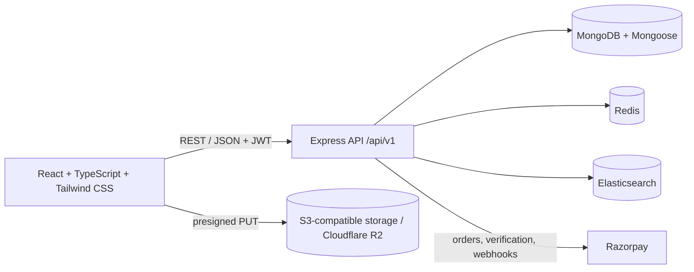

# Architecture and local setup

Marketly is a React storefront backed by a TypeScript Express API. The app supports customer, vendor, and admin roles.

## System overview



MongoDB is the source of truth for users, vendors, products, carts, orders, payments, and related records. MongoDB runs as a single-node replica set locally because transactions are used for checkout and guest-cart merging. Elasticsearch holds a product search index. Redis is used for short-lived upload sessions and coordination locks. Product and KYC images are uploaded directly to configured S3-compatible storage using short-lived presigned URLs.

The original project brief specified PostgreSQL and Prisma; this repository currently uses MongoDB and Mongoose. Razorpay payment order creation, verification, refunds, and webhooks are implemented, but vendor settlement releases are simulated and do not transfer funds.

## Repository layout

| Path | Contents |
| --- | --- |
| `frontend/` | React application, Vite configuration, UI, API client, and frontend build |
| `backend/src/routes/` | Express route handlers grouped by domain |
| `backend/src/models/` | Mongoose models and indexes |
| `backend/src/middleware/` | JWT authentication and role checks |
| `backend/src/utils/` | Redis, Elasticsearch, object storage, Razorpay, and PDF helpers |
| `backend/src/tests/` | Backend unit, integration, and end-to-end test files |
| `docs/api/` | Endpoint reference, including documented placeholders and access behavior |
| `seed/` | Local/demo data and placeholder images |
| `compose.yaml` | Local MongoDB, Redis, and Elasticsearch services |

## Local services

`docker compose up -d` starts:

| Service | Local port | Purpose |
| --- | ---: | --- |
| MongoDB | `27017` | Persistent application data; initialized as replica set `rs0` |
| Redis | `6379` | Upload session cache and mutex/coordination support |
| Elasticsearch | `9200` | Product search index |

Compose starts these dependencies only; the API and frontend run as separate development processes.

## Environment configuration

Copy `backend/.env.example` to `backend/.env` and `frontend/.env.example` to `frontend/.env`.

### Backend variables

| Variable | Purpose |
| --- | --- |
| `MONGODB_URI` | MongoDB connection string; local example targets replica set `rs0` |
| `JWT_SECRET` | Signs authentication tokens; set a unique random value |
| `BANK_DETAILS_ENCRYPTION_KEY` | Dedicated encryption key for vendor bank details; if blank, code falls back to `JWT_SECRET` |
| `REDIS_URL` | Redis connection string |
| `ELASTICSEARCH_URL`, `ELASTICSEARCH_USERNAME`, `ELASTICSEARCH_PASSWORD` | Elasticsearch connection |
| `OBJECT_STORAGE_PROVIDER`, `OBJECT_STORAGE_BUCKET` | Select and name the S3-compatible bucket |
| `S3_REGION`, `S3_ENDPOINT`, `S3_ACCESS_KEY_ID`, `S3_SECRET_ACCESS_KEY` | AWS S3 or compatible credentials |
| `R2_ACCOUNT_ID` | Cloudflare R2 account identifier when using R2 |
| `RAZORPAY_KEY_ID`, `RAZORPAY_KEY_SECRET`, `RAZORPAY_WEBHOOK_SECRET` | Razorpay test credentials and webhook verification |

The object storage settings are needed for real image upload and the full seed flow. Razorpay credentials are needed to complete payment flows. Use test credentials locally. Confirm the provider variable names in the checked-in env example and `backend/src/utils/razorpay.ts` when configuring a different deployment.

### Frontend variables

| Variable | Purpose |
| --- | --- |
| `VITE_API_BASE_URL` | API base URL, normally `http://localhost:3000/api/v1` |
| `VITE_R2_PUBLIC_BASE_URL` | Public image base URL used to render uploaded product images |
| `VITE_RAZORPAY_KEY_ID` | Public Razorpay key used by checkout |
| `VITE_APP_NAME` | App display name |

## Local setup

See the [root README](../README.md) for full prerequisites and commands. The short version is:

```sh
npm install --prefix backend
npm install --prefix frontend
cp backend/.env.example backend/.env
cp frontend/.env.example frontend/.env
docker compose up -d
```

Configure the env files before starting the app. Then run `npm run back:dev` in one terminal and `npm run front:dev` in a second terminal. The full seed uses `SEED_ALLOW_RESET=true npm run seed`; it deletes and recreates the configured local database and search index, and requires object storage credentials for placeholder image uploads.

## Data and API documentation

The high-level schema and planned API surface are described in [`SPEC.md`](../SPEC.md). The route reference under [API documentation](api/README.md) describes implemented behavior, including routes that remain placeholders.

## Known limitations

- Persistence uses MongoDB/Mongoose rather than the brief's PostgreSQL/Prisma stack.
- Seller settlement records are simulated; no seller bank transfer is initiated.
- Elasticsearch synchronization retries are in memory and are lost when the API restarts. Existing products are not automatically backfilled; see [search notes](api/search.md).
- Some documented routes remain placeholders. The API pages identify them and describe their current response.
- The frontend has a Cloudflare Pages deploy command, but no backend deployment configuration or public demo is included in this repository.
